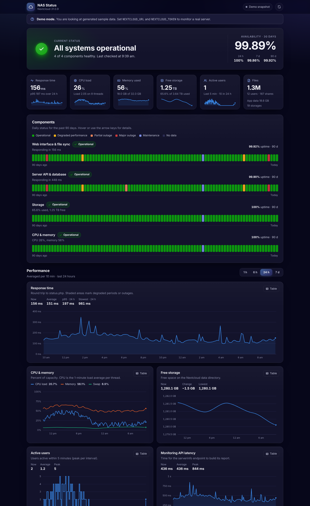
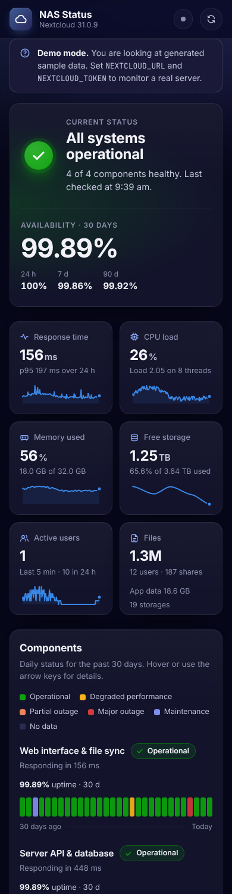

# NAS Status

A polished, self-hosted status page for **Nextcloud**, powered by the official
[serverinfo](https://github.com/nextcloud/serverinfo) external monitoring API.

It polls your server, keeps its own history, works out uptime and incidents,
and presents everything on a dark, fast, dependency-free dashboard.



<details>
<summary>Mobile layout</summary>



</details>

## Contents

- [Features](#features)
- [How it works](#how-it-works)
- [Quick start](#quick-start)
- [Configuration](#configuration)
- [How status is decided](#how-status-is-decided)
- [JSON API](#json-api)
- [Deploying behind a reverse proxy](#deploying-behind-a-reverse-proxy)
- [Security notes](#security-notes)
- [Troubleshooting](#troubleshooting)
- [Development](#development)

## Features

- **Live overall status** with an animated status orb, plus 24 h, 7 d, 30 d and 90 d availability.
- **Four monitored components:** web and file sync, server API and database, storage, and CPU and memory.
- **90-day uptime bars** for each component, in the style of hosted status pages. Every day has a tooltip breakdown.
- **Interactive charts** for response time, CPU, memory, swap, free storage, active users and API latency.
  - Choose a 1 h, 6 h, 24 h or 7 d range.
  - Crosshair tooltips work with the mouse, touch or keyboard.
  - Outage periods are shaded, and every chart has a table view.
- **Radial gauges** for CPU, memory, swap and storage, plus CPU temperatures when available.
- **Detail tables** cover system versions, usage, shares (with a donut chart), active users, PHP and caching (OPcache and APCu hit rates), app updates and disk volumes.
- **Automatic incident history.** Incidents open and close from consecutive checks and include a timeline of updates.
- **Built for real-world failures.**
  - Timeouts, refused connections, maintenance mode and bad tokens are each handled and explained.
  - The last good figures are kept and clearly marked as stale.
- **Zero runtime dependencies.** You only need Node.js 18.17 or newer, and the page loads nothing from the internet.
- **Ready for Docker,** with a health check, a non-root user and a persistent data volume.
- **Demo mode** lets you preview the page with 90 days of realistic generated data.

## How it works

```
Browser ──► NAS Status (Node.js) ──► Nextcloud
             │  polls every 60 s       ├─ /status.php                         (public: reachability, maintenance)
             │  stores history         ├─ /ocs/v2.php/apps/serverinfo/api/v1/info      (NC-Token)
             │  serves the page        ├─ …/diskdata   (optional, admin app password)
             └─ data/history.json      └─ …/basicdata  (optional, admin app password)
```

The browser never talks to Nextcloud directly. Your token stays on the server, and
cross-origin (CORS) problems are avoided entirely. History lives in
`data/history.json`:

| Data | Kept for |
| --- | --- |
| Raw checks | 7 days |
| Daily summaries | 90 days |
| Incidents | 90 days |

The file is written atomically every five minutes and on shutdown.

## Quick start

### 1. Create a monitoring token on Nextcloud

The serverinfo app ships with Nextcloud and is enabled by default. Generate a long
random token and store it in Nextcloud's app config.

```bash
# Standard install (adjust the path and web server user to suit)
sudo -u www-data php /var/www/nextcloud/occ config:app:set serverinfo token --value "$(openssl rand -hex 32)"

# Nextcloud All-in-One
sudo docker exec --user www-data -it nextcloud-aio-nextcloud php occ config:app:set serverinfo token --value "$(openssl rand -hex 32)"

# Read the token back so you can copy it
sudo -u www-data php /var/www/nextcloud/occ config:app:get serverinfo token
```

Check that it works before going further:

```bash
curl -H "NC-Token: YOUR_TOKEN" \
  "https://cloud.example.com/ocs/v2.php/apps/serverinfo/api/v1/info?format=json"
```

You should get back JSON that starts with `{"ocs":{"meta":{"status":"ok"`.

### 2. Configure

```bash
git clone https://github.com/Liam-burnett-AU/Nas-Status.git
cd Nas-Status
cp .env.example .env
# edit .env: set NEXTCLOUD_URL, NEXTCLOUD_TOKEN and TIMEZONE
```

### 3a. Run with Docker (recommended)

```bash
docker compose up -d --build
# open http://localhost:8080
```

### 3b. Or run with Node.js

```bash
npm start
# open http://localhost:8080
```

### Just want a look first?

```bash
npm run demo        # serves generated data on http://localhost:8080
```

You can also build a single, self-contained HTML snapshot of the demo:

```bash
npm run build:preview   # writes dist/preview.html
```

## Configuration

Settings come from environment variables or a `.env` file. Real environment
variables always take priority over the file. The server refuses to start with a
clear message if any value is invalid.

| Variable | Default | Description |
| --- | --- | --- |
| `NEXTCLOUD_URL` | — | **Required.** Base URL, including any sub-path such as `https://example.com/nextcloud`. |
| `NEXTCLOUD_TOKEN` | — | serverinfo token from step 1. Without it, only reachability is monitored. |
| `NEXTCLOUD_USER` / `NEXTCLOUD_APP_PASSWORD` | — | Optional admin **app password**. Unlocks disk volumes, server uptime and temperatures. |
| `SITE_TITLE` | `NAS Status` | Title shown in the header and browser tab. |
| `SITE_DESCRIPTION` | … | Meta description. |
| `TIMEZONE` | system zone | IANA zone such as `Australia/Brisbane`. Used for daily bars and every displayed time. |
| `SHOW_SERVER_DETAILS` | `true` | Show versions, PHP, database, caching and app details. Set `false` on a public page. |
| `POLL_INTERVAL_SECONDS` | `60` | How often to check, from 15 to 3600. |
| `REQUEST_TIMEOUT_SECONDS` | `10` | A request taking longer than this counts as unreachable. |
| `INCIDENT_THRESHOLD` | `2` | Consecutive bad checks needed to open an incident, and good checks needed to close it. |
| `RESPONSE_DEGRADED_MS` | `1500` | A `status.php` response slower than this counts as degraded. |
| `API_DEGRADED_MS` | `5000` | A serverinfo response slower than this counts as degraded. |
| `CPU_DEGRADED_PERCENT` | `90` | Load per thread, as a percentage, that counts as degraded. |
| `MEMORY_DEGRADED_PERCENT` | `90` | Memory use that counts as degraded. |
| `DISK_WARN_PERCENT` / `DISK_CRITICAL_PERCENT` | `85` / `95` | Volume use thresholds, used when the volume size is known. |
| `DISK_WARN_FREE_GB` / `DISK_CRITICAL_FREE_GB` | `50` / `10` | Free-space thresholds, used when only free space is known. |
| `HOST` / `PORT` | `0.0.0.0` / `8080` | Listen address. |
| `DATA_DIR` | `./data` | Where `history.json` is stored. |
| `LOG_LEVEL` | `info` | `debug`, `info`, `warn` or `error`. |
| `DEMO_MODE` | `false` | Serve generated data instead of polling Nextcloud. |

> **Why an app password for the extras?** Upstream, `diskdata` and `basicdata`
> only accept a logged-in admin. They do not accept the `NC-Token`. Create a
> dedicated app password under *Personal settings → Security* so you can revoke
> it independently.

## How status is decided

| Component | Operational | Degraded | Partial outage | Major outage |
| --- | --- | --- | --- | --- |
| Web interface & file sync | `status.php` answers quickly | Slower than `RESPONSE_DEGRADED_MS` | — | Unreachable, timed out or not installed |
| Server API & database | serverinfo answers | Slow, or a database upgrade is pending | serverinfo errors while the web works | Server unreachable |
| Storage | Below the warning level | At or above the warning level | At or above the critical level | — |
| CPU & memory | Below the thresholds | CPU or memory over its threshold | — | — |

The following rules apply on top of the table:

- **Maintenance mode** in `status.php` shows *Under maintenance*. Those checks are left out of uptime.
- **A rejected token** shows the API as *No data*, not as an outage, because it is a monitor configuration problem.
- **Uptime** counts operational and degraded checks as up, and partial or major outages as down.
- **Back-off.** Nextcloud's brute-force protection throttles IP addresses that keep sending bad credentials. After a rejection, authenticated calls back off exponentially, up to 30 minutes, while `status.php` keeps being checked on schedule.

## JSON API

| Endpoint | Description |
| --- | --- |
| `GET /api/status` | Current status, components with 90-day daily series, availability, metrics, details and incidents. |
| `GET /api/history?range=1h\|6h\|24h\|7d` | Bucketed time series for the charts. |
| `GET /healthz` | Returns `200` while checks complete on schedule and `503` if the monitor has stalled. It reports on the monitor, not on Nextcloud. |

Every field in `/api/status` is explicitly whitelisted. Tokens, passwords, PHP-FPM
request URIs and PHP extension names are never exposed.

## Deploying behind a reverse proxy

The page uses relative URLs, so it works at a sub-path such as
`https://example.com/status/`. Here is an nginx example:

```nginx
location /status/ {
    proxy_pass http://127.0.0.1:8080/;
    proxy_set_header Host $host;
    proxy_set_header X-Forwarded-Proto $scheme;
}
```

Here is a systemd unit if you are not using Docker:

```ini
[Unit]
Description=NAS Status
After=network-online.target

[Service]
WorkingDirectory=/opt/nas-status
ExecStart=/usr/bin/node server.js
Restart=on-failure
User=nas-status
EnvironmentFile=/opt/nas-status/.env

[Install]
WantedBy=multi-user.target
```

## Security notes

- **The token stays server-side.** The browser only sees the sanitised `/api/status` output.
- **Exposing versions can help attackers.** Set `SHOW_SERVER_DETAILS=false` before publishing the page to the internet.
- **Strict response headers.** The page sends a Content Security Policy, `nosniff`, `no-referrer` and frame protection. Static file paths are protected against directory traversal.
- **The container runs as a non-root user.**

## Troubleshooting

| Message | Fix |
| --- | --- |
| `Authentication rejected` | The token does not match. Re-run `occ config:app:get serverinfo token` and copy it exactly. |
| `Response was not JSON - this host is not in Nextcloud's trusted_domains` | Add the host name you use in `NEXTCLOUD_URL` to `trusted_domains` in `config.php`. |
| `Unexpected redirect` | Check `http` versus `https` and the sub-path in `NEXTCLOUD_URL`. |
| `TLS certificate not trusted` | Self-signed certificates need `NODE_EXTRA_CA_CERTS=/path/to/ca.pem`. TLS verification is never disabled. |
| `Response is not an OCS envelope` | Enable the app with `occ app:enable serverinfo`. |
| Free storage shows *size unknown* | Add the admin app password so the data volume can be matched from `diskdata`. |

## Development

```bash
npm test               # 48 tests: normaliser, evaluator, history store, client, and end-to-end against a mock Nextcloud
npm run demo           # local preview with generated data
npm run build:preview  # single-file HTML snapshot in dist/
```

```
server.js            HTTP server, static files, API routes, start-up and shutdown
lib/config.js        environment parsing and validation
lib/nextcloud.js     API client (timeouts, auth, helpful errors)
lib/normalise.js     raw serverinfo payload to a clean snapshot (units, -1 and false sentinels)
lib/evaluate.js      component and overall status rules
lib/store.js         history, uptime maths, incidents, persistence
lib/monitor.js       polling loop with auth back-off
lib/api.js           whitelisted public payload
lib/demo.js          realistic generated data in serverinfo's own format
public/              the page (HTML, CSS, dependency-free SVG charts)
```

Built by Liam Burnett · LB Dev. MIT licence.
